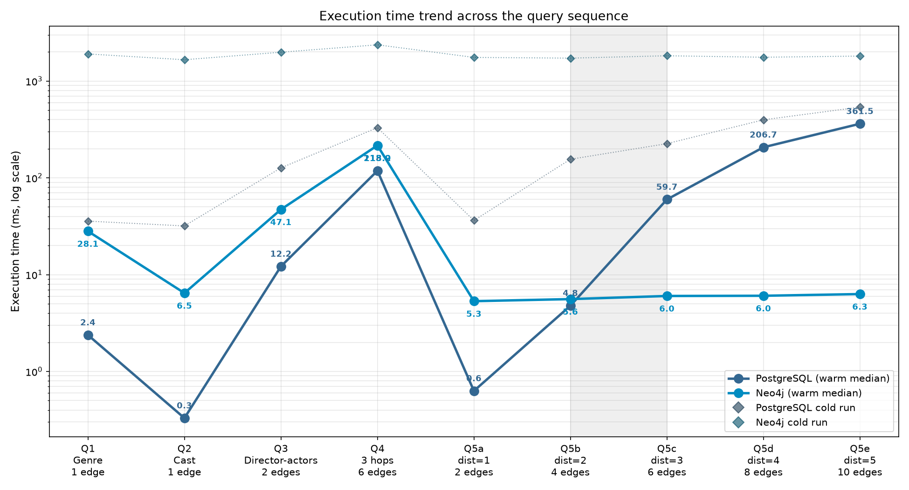
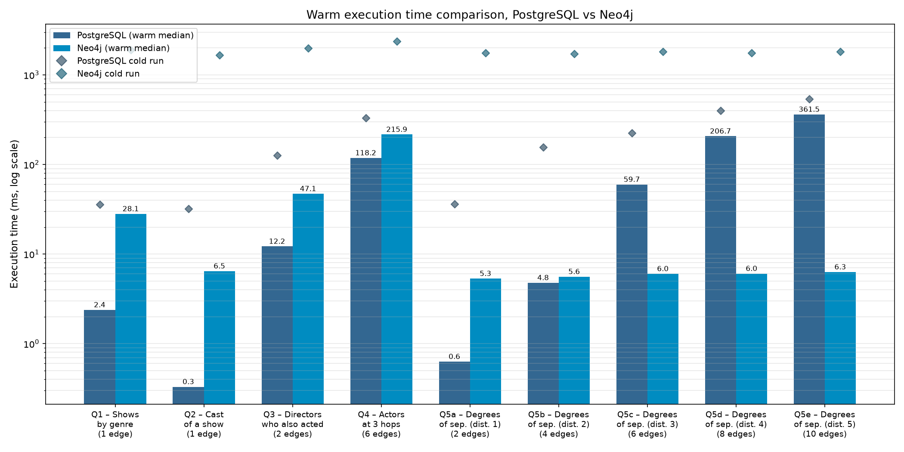

# PostgreSQL vs Neo4j — When Does a Graph Database Pay Off?

*Data Management course project*

A performance comparison between a relational database (**PostgreSQL 16**) and a graph database (**Neo4j**) on the same data: the Netflix Movies and TV Shows catalogue, with 8,807 titles, 40,948 people and about 100,000 relationships.

Both systems hold identical data, answer the same nine questions, use equivalent indexes, and are measured in the same way. The questions range from a simple lookup to a shortest-path search across five co-acting hops.



## Key Findings

| Query | What it asks | Edges traversed | PostgreSQL (ms) | Neo4j (ms) | Faster |
|---|---|:---:|---:|---:|---|
| Q1 | Titles of a genre | 1 | 2.4 | 28.1 | PostgreSQL 12× |
| Q2 | Cast of a show | 1 | 0.3 | 6.5 | PostgreSQL 22× |
| Q3 | Directors who also acted | 2 | 12.2 | 47.1 | PostgreSQL 3.9× |
| Q4 | Actors at exactly 3 hops | 6 | 118.2 | 215.9 | PostgreSQL 1.8× |
| Q5a | Degrees of separation, distance 1 | 2 | 0.6 | 5.3 | PostgreSQL 8.8× |
| Q5b | Degrees of separation, distance 2 | 4 | 4.8 | 5.6 | PostgreSQL 1.2× |
| Q5c | Degrees of separation, distance 3 | 6 | 59.7 | 6.0 | **Neo4j 10×** |
| Q5d | Degrees of separation, distance 4 | 8 | 206.7 | 6.0 | **Neo4j 34×** |
| Q5e | Degrees of separation, distance 5 | 10 | 361.5 | 6.3 | **Neo4j 57×** |

*Warm median of 5 runs after a true cold start. Factor = slower median / faster median.*

- **PostgreSQL wins on lookups and shallow joins**, by up to 22×. Its optimizer and B-tree indexes are hard to beat when the work is small.
- **Neo4j wins on deep path searches, and its lead grows with depth.** Its time stays around 6 ms whatever the distance, because each hop follows a stored pointer. In PostgreSQL each hop is another join, and the cost grows at every level.
- **Enumerating is not the same as searching.** Q4 and Q5c both traverse 6 edges, but PostgreSQL wins Q4 and Neo4j wins Q5c. Q4 must list all 13,326 actors at that distance; Q5c looks for one path and stops as soon as it finds it.
- **In SQL, how a traversal is written matters as much as the database.** A naive recursive query that enumerates every path returns the same answer as a breadth-first one, but is 81× slower at distance 3 (4,842 ms against 60 ms) and infeasible beyond it.

## Making the Comparison Fair

| Concern | Solution |
|---|---|
| Same data | One cleaning script produces both imports; entity and relationship counts are checked to match exactly |
| Same questions | SQL and Cypher versions of each query are equivalent; all nine return the same number of rows in both systems |
| Same indexing | Every property used as a search key is indexed in both systems |
| Comparable algorithms | Shortest path uses a breadth-first recursive CTE in SQL, like Neo4j's `shortestPath()` |
| True cold start | Before every query, on every system: services stopped, OS page cache flushed, services restarted |
| Same measurement | Native drivers, one fresh connection per block, full result materialization, median of warm runs |

## Repository Structure

```
.
├── data/
│   └── raw/netflix_titles.csv          source dataset (Kaggle)
├── database/
│   ├── import_postgres.sql             relational schema, indexes, data load
│   └── import_neo4j.cypher             graph constraints, indexes, data load
├── scripts/
│   ├── clean_netflix_data.py           normalization and deduplication
│   ├── cold_reset.py                   clears every cache layer before a measurement
│   ├── benchmark_final.py              main benchmark (9 queries)
│   ├── generate_bar_chart.py
│   └── generate_line_chart.py
├── results/                            benchmark output (CSV)
├── figures/                            charts (PNG)
└── docs/
    ├── PROJECT_DOCUMENTATION.md        every phase, design choice and query explained
    └── PostgreSQL_vs_Neo4j_presentation.pdf
```

## Running the Project

**Requirements:** Ubuntu with PostgreSQL 16, Neo4j 5+ (Java 21), Python 3.10+, and `sudo` access (needed for the cold reset).

All commands are run from the repository root.

**1. Set up Python and the credentials**

```bash
python3 -m venv venv
source venv/bin/activate
pip install -r requirements.txt

export PG_PASSWORD='your-postgres-password'
export NEO4J_PASSWORD='your-neo4j-password'
```

**2. Clean the data**

```bash
python3 scripts/clean_netflix_data.py
```

**3. Load PostgreSQL**

```bash
psql -U postgres -h localhost -d postgres -c "CREATE DATABASE netflix_db;"
psql -U postgres -h localhost -d netflix_db -f database/import_postgres.sql
```

**4. Load Neo4j**

```bash
sudo cp data/clean/neo4j/*.csv /var/lib/neo4j/import/
sudo chmod 644 /var/lib/neo4j/import/*.csv
cat database/import_neo4j.cypher | cypher-shell -u neo4j -p "$NEO4J_PASSWORD"
```

**5. Run the benchmarks and draw the charts**

```bash
python3 scripts/benchmark_final.py
python3 scripts/generate_bar_chart.py
python3 scripts/generate_line_chart.py
```

The benchmark takes about 15–20 minutes. Avoid using the machine meanwhile: other activity refills the OS cache and alters the cold measurements.

## Results in Detail



Diamonds mark the cold run (first execution after a full cache reset). Raw numbers, including cold times and the naive SQL variant, are in [`results/benchmark_final_results.csv`](results/benchmark_final_results.csv).

## Documentation

[`docs/PROJECT_DOCUMENTATION.md`](docs/PROJECT_DOCUMENTATION.md) walks through every phase of the project: data cleaning, both data models, the indexing strategy, the measurement method, and each query in SQL and Cypher with an explanation of how each engine executes it. The slides are in [`docs/PostgreSQL_vs_Neo4j_presentation.pdf`](docs/PostgreSQL_vs_Neo4j_presentation.pdf).

## Author

Andrei Rares Grigore (1953878) — NoSQL course project.
